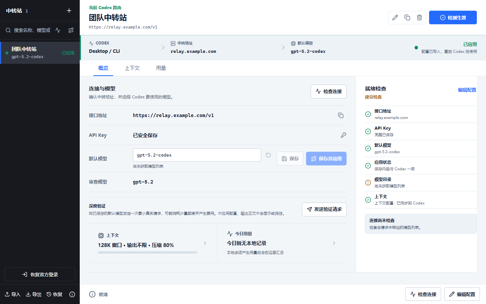
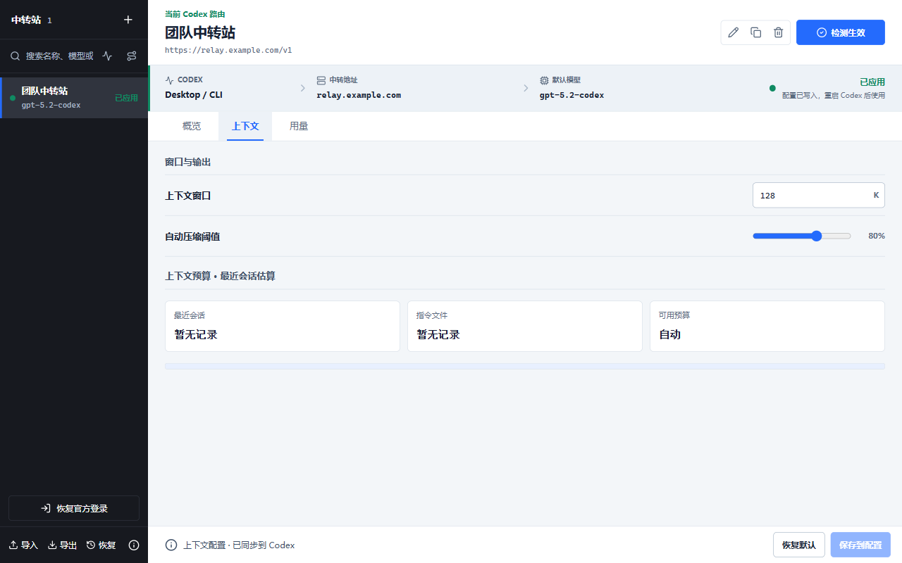
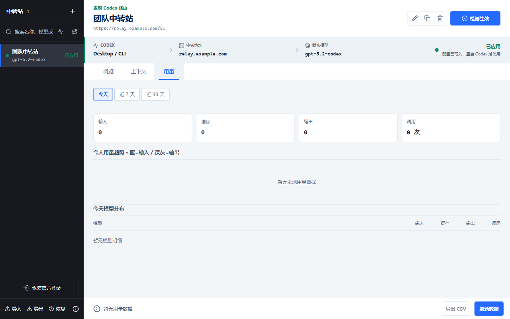

<div align="center">
  
  <h1>Codex Switch</h1>
  <p>面向 Codex Desktop 与 Codex CLI 的中转站配置切换工具</p>

  [](https://github.com/bilbilmyc/codex-switch/releases/latest)
  [](https://github.com/bilbilmyc/codex-switch/actions/workflows/ci.yml)
  [](https://github.com/bilbilmyc/codex-switch/releases/latest)
  [](https://github.com/bilbilmyc/codex-switch/releases/latest)
  [](LICENSE)
</div>

> [!IMPORTANT]
> **V2 是当前唯一主线版本。** `main` 分支中的桌面应用位于 `v2/`，使用 Tauri 2、React 和 Rust 构建，后续开发、构建与发布都以 V2 为准。根目录保留的 Slint V1 界面已经冻结，仅作为历史代码保留，不再增加功能、维护界面或发布安装包。

Codex Switch 用来保存多个 API Key 中转站，并在不覆盖其他 Codex 设置的前提下切换服务地址、模型与上下文参数。它同时提供配置备份、冲突检测、路由巡检、本地 Token 用量统计，以及一键恢复官方 ChatGPT 登录配置。



## 快速开始

1. 从 [GitHub Releases](https://github.com/bilbilmyc/codex-switch/releases/latest) 下载当前平台的最新安装包。
2. 打开 Codex Switch，点击左上角的“新建中转站”。
3. 填写名称、接口地址、API Key 和默认模型，然后保存。
4. 点击列表中该中转站旁的“切换”，或在详情页点击“切换到此中转站”。原配置会自动备份，不需要选择导入或覆盖。
5. Codex Desktop 正在运行时，选择“重启 Codex 并切换”；命令行任务结束后，重新打开 Codex CLI。

“保存”只更新 Codex Switch 自己的数据；“切换”才会修改 `~/.codex/config.toml`、`~/.codex/auth.json` 和工具管理的模型目录。顶部会显示当前写入的配置；点击中转站名称只查看详情，点击旁边的“切换”才会更改配置。

需要切回官方服务时，点击侧栏顶部“ChatGPT 官方”旁的“切换”。Codex Switch 会先备份当前配置，再恢复 OpenAI 服务商与 ChatGPT 登录方式，同时保留已保存的中转站和认证文件中已有的官方会话。重新打开 Codex 后，如本机没有有效官方会话，再按 Codex 提示使用 ChatGPT 账号登录即可；Codex Switch 不代为执行 OAuth 登录。

导入、导出、备份恢复和全部中转站检查集中在侧栏底部的“更多”中；连接检查与高级信息默认收起，日常切换无需先执行这些检查。“更多”中的“检查当前配置”只读取并比对落盘配置，不会重复写入或创建备份。

## 主要功能

- 保存、搜索、复制、导入、导出和快速切换多个中转站。
- 为每个中转站独立保存默认模型、审查模型、上下文窗口和自动压缩阈值。
- 使用 Bearer API Key 请求标准 `GET /models` 接口；接口不可用时仍可手动填写完整模型 ID。
- 检查单个中转站连接，或一次巡检全部中转站并保存最近结果。
- 可选发送一次最小真实请求，验证当前凭据、路由和默认模型是否可用。
- 应用前自动备份，保留最近 10 份，并在备份中心预览差异后恢复。
- 检测 Codex 配置被其他工具修改的冲突，以及正在运行的 Codex CLI/Desktop 进程。
- 从本地 Codex 会话日志统计输入、缓存、输出、调用次数、趋势和模型分布，并导出 CSV。
- 一键恢复官方 ChatGPT 登录配置，之后仍可随时切回已保存的中转站。

<table>
  <tr>
    <td width="50%"></td>
    <td width="50%"></td>
  </tr>
  <tr>
    <td align="center">上下文窗口与自动压缩阈值</td>
    <td align="center">本地 Token 用量统计</td>
  </tr>
</table>

## 安装与升级

| 平台 | 安装包 | 说明 |
| --- | --- | --- |
| Windows | x64 NSIS `.exe` | 默认按当前用户安装，不要求为所有用户安装 |
| macOS | Universal `.dmg` | 同时支持 Apple Silicon 与 Intel |

V2 沿用原有的产品名 `Codex Switch`、应用标识 `com.mayc.codex-switch` 和可执行文件名 `codex-switch`。从 V1 升级时，Windows 安装器会沿用原安装目录；macOS 可将新版 `Codex Switch.app` 拖入“应用程序”并确认替换。升级前请先退出旧版应用。

V1 与 V2 共用 `~/.codex-switch` 和 `~/.codex`，正常升级不会删除中转站、密钥或备份。早期单独安装的 `Codex Switch V2` alpha 包使用过不同的安装身份，应先卸载程序本体再安装当前版本，但不要删除上述共享配置目录。

当前公开构建没有 Apple Developer ID 公证，Windows SmartScreen 或 macOS Gatekeeper 可能显示来源提示。请只使用本仓库 Release 或自行构建的安装包。

## 写入范围

应用中转站时，Codex Switch 对 `~/.codex/config.toml` 做保留格式的局部修改，主要维护以下内容：

```toml
model_provider = "codex_switch_a1b2c3d4e5f6478899aabbccddeeff00"
model = "中转站默认模型"
# 可选：
review_model = "中转站审查模型"
model_context_window = 272000
model_auto_compact_token_limit = 217600
model_auto_compact_token_limit_scope = "total"

[model_providers.codex_switch_a1b2c3d4e5f6478899aabbccddeeff00]
name = "中转站名称"
base_url = "https://relay.example/v1"
wire_api = "responses"
requires_openai_auth = true
```

工具只更新 `~/.codex/auth.json` 中的 `OPENAI_API_KEY`，并保留其他字段、其他 provider 和未受管理的 Codex 设置。上下文恢复默认时会移除工具管理的上下文字段，让 Codex 回到模型默认值。

选择模型并应用时，工具会为完整模型 ID 生成或更新托管目录：

```text
~/.codex/model-catalogs/codex-switch-models.json
```

生成时优先保留当前目录或 `~/.codex/models_cache.json` 中精确匹配的能力信息，不会把相似型号的参数套到新模型上。托管目录会和 `config.toml`、`auth.json` 一起备份、回滚和恢复。

## 切换安全

每次切换都会依次执行校验、备份、原子写入和结果检查；写入失败时会尝试回滚，下次启动也会检查未完成事务。普通中转站切换会自动备份外部修改后的配置，再更新工具管理的字段，保留其他设置。上下文同步仍会在检测到冲突时提示如何处理。

切换中转站与官方登录时，工具都会将 `cli_auth_credentials_store` 设为 `file`，使 Codex 使用工具实际写入的 `auth.json`。这可避免 `keyring` 或 `auto` 模式继续读取系统钥匙串中的旧凭据。中转站 API Key 不会清除认证文件中已有的官方 OAuth 会话；切回官方时会移除中转站的 API 认证信息。

Codex Desktop 或 CLI 仍在运行时，旧配置可能已经加载到内存，也可能在退出时再次写入文件。Codex Switch 会提示风险，并在支持的平台上尝试正常退出和重新启动桌面应用。请勿在重要 Codex 任务执行期间强制切换。

备份恢复会覆盖对应的 Codex 配置文件；删除 Codex Switch 中保存的中转站则不会自动修改当前已应用的 Codex 配置。

## 数据与隐私

Codex Switch 的本地数据统一保存在 `~/.codex-switch`：

| 路径 | 内容 |
| --- | --- |
| `profiles.toml` | 中转站、模型、上下文配置和 API Key |
| `state.json` | 当前应用状态与冲突检测信息 |
| `model-cache/` | 各中转站最近获取的模型列表 |
| `usage.sqlite3` | 本地 Token 用量索引与统计缓存 |
| `backups/` | 应用或恢复前创建的 Codex 配置备份 |
| `logs/` | 启动、校验、切换、冲突、回滚与恢复日志 |

用量统计只扫描当前用户的 `~/.codex/sessions/` 和 `~/.codex/archived_sessions/`。数据库保存来源文件元数据和聚合统计，不保存消息正文、原始日志行、完整配置或 API Key；日志也不会记录 API Key 或 `auth.json` 内容。

本地文件不会额外加密，`profiles.toml` 与备份中的 API Key 是明文。macOS/Unix 上工具会尽量将目录和文件权限限制为 `0700` 和 `0600`；Windows 上依赖当前用户账户与磁盘权限。请勿把 `~/.codex-switch` 提交到 Git、同步到公开网盘或发送给他人。

## 本地开发

需要 Rust 1.92 或更高版本、Node.js、pnpm、Tauri 2 CLI，以及当前平台的 Rust 原生构建工具链。

在仓库根目录安装前端依赖：

```bash
pnpm --dir v2/frontend install --frozen-lockfile
```

启动 V2：

```bash
cd v2/src-tauri
cargo tauri dev
```

运行检查：

```bash
cargo test
pnpm --dir v2/frontend test
pnpm --dir v2/frontend build
```

开发与测试会读写当前用户的 `~/.codex` 和 `~/.codex-switch`。使用真实配置测试前，请先备份 `~/.codex/config.toml` 与 `~/.codex/auth.json`。

## 构建 V2

```bash
cd v2/src-tauri
cargo tauri build
```

Windows 只生成 NSIS 安装器：

```bash
cargo tauri build --bundles nsis
```

macOS 通用包需要在 macOS 上构建：

```bash
rustup target add aarch64-apple-darwin x86_64-apple-darwin
cd v2/src-tauri
cargo tauri build --target universal-apple-darwin --bundles app,dmg
```

GitHub Actions 会在 `main` 上运行共享 Rust 后端和 V2 前端检查。只有推送与 `v2/src-tauri/Cargo.toml` 版本一致的正式 `v<version>` tag 时，发布工作流才会创建 Release；普通代码推送不会发布安装包。

## V1 冻结说明

根目录的 Slint 应用是历史 V1 界面。自 V2 成为主线后：

- V1 不再增加功能、调整界面或发布安装包。
- V1 不作为新问题的修复目标，也不再要求与 V2 同步实现。
- 根目录 Rust crate 仍包含 V2 复用的共享后端，因此不能简单删除；涉及共享逻辑的修改仍需运行 Rust 测试。
- 所有用户文档、截图、构建说明和 GitHub Release 均以 V2 为准。

## 许可

Codex Switch 使用 [MIT License](LICENSE)。[简体中文译文](LICENSE.zh-CN.txt) 仅供阅读，英文文本为权威版本。Lucide 图标与历史 V1 使用的 Slint 许可及归属说明见 [THIRD_PARTY_LICENSES.md](THIRD_PARTY_LICENSES.md)。
